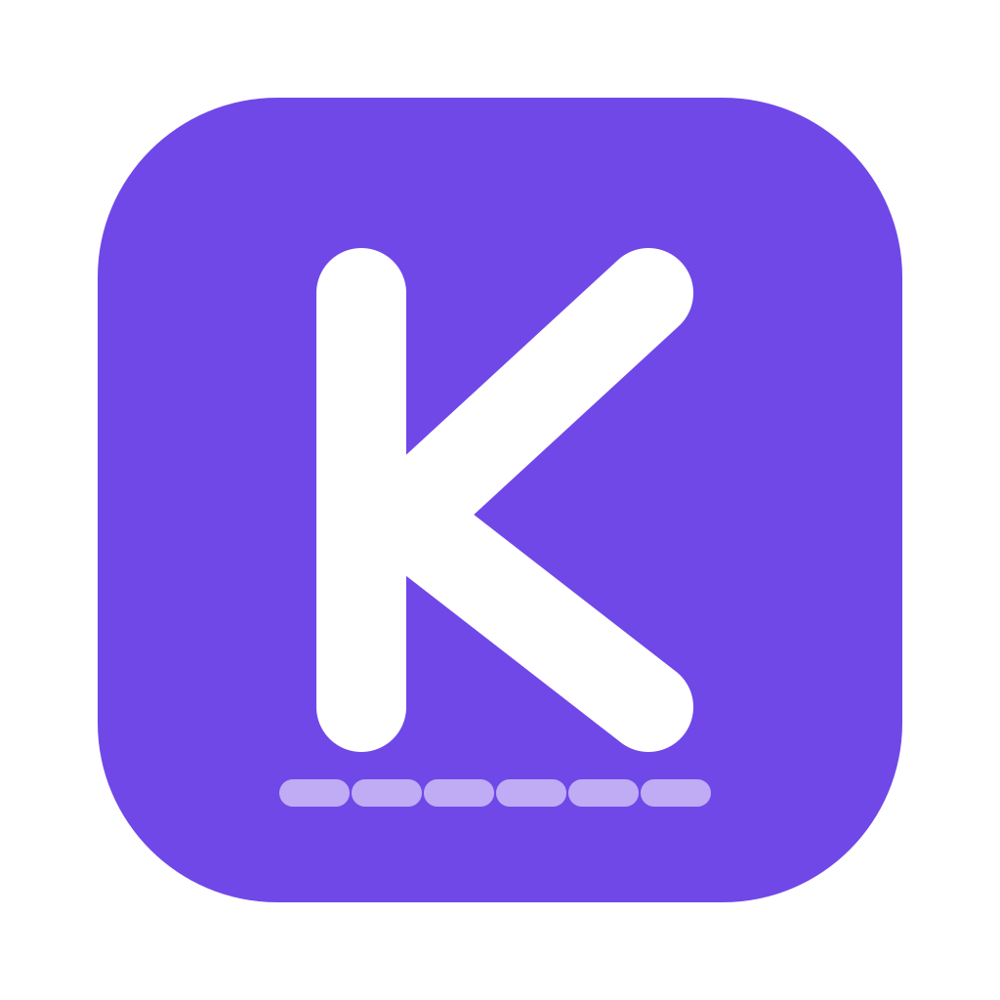

<div align="center">



# Kerf

**A fast, offline desktop editor for cutting machines.**

[](https://github.com/alankey-dev/kerf/actions/workflows/ci.yml)


</div>

Kerf is an open-source SVG canvas and editor for cutting machines, written in Rust with [egui](https://github.com/emilk/egui). It has no account, no subscription and no cloud. It drives real HPGL and G-code cutters over serial.

## Features

- **Design.** Shapes with live parameters (corner radii, polygon sides, star points and arcs you edit after placing), Pen and Pencil, node editing, the Corner tool to round, chamfer or scoop any corner, Weld, Slice, Flatten, Shape Builder and Knife, live effects (Offset, Sticker, Warp), groups, containers with Row, Column, Grid and Radial auto layout and reusable components.
- **Repeat and transform.** Power Duplicate and Transform Again repeat the last step, Step and repeat and Rotate copies make a grid or a ring in one go, a movable pivot turns a shape about any point, and skew leans it along either axis.
- **Text.** System fonts, text on a path with draggable handles, curved text, and single-line writing fonts for pens.
- **Colour.** A swatch picker with project colours, recent and saved swatches and bundled palettes, per-document swatches you save with a project, an eyedropper that lifts a style or samples a colour from an image, and Replace colour to swap one colour everywhere.
- **Selection.** Shift-click and marquee, an Option-drag lasso, Select Same by colour, operation, pen, font, kind or effects, Select Inverse, and Tab through the layers.
- **Monograms.** Initials in six layout styles inside nine original frames, from five themes, editable after inserting.
- **Images.** Upload, trace to cut paths, and Print Then Cut.
- **Clipboard.** Cut, copy and paste native designs, SVG paths and plain text across tabs and apps.
- **Create AI.** Describe a design and a model draws it as cut-ready vectors: Claude, OpenAI or OpenRouter with your own API key, or a local model.
- **Make.** Mats composed by colour, Optimise layout (nesting), cut path preview with time estimates, and the full Set, Load, Go flow.
- **Open cutters.** Plot to HPGL and G-code devices with blade offset, overcut and plot order.
- **USB detection.** Recognise a plugged-in open cutter by its USB descriptor and set it up in one click.
- **Export.** SVG, DXF, PDF, PNG, JPEG, and per-mat files to finish a project in Design Space. SVG files import back as named, nested layers keeping their strokes and colours.
- **Guides.** Ruler guides you drag out, snap to, type, lock and keep with the project.
- **Snapping.** One magnet pulls moves, resizes and the Pen to the grid, shape edges and centres, nodes and midpoints, intersections, guides, the mat and equal gaps, with a switch per class and a Shift lock to horizontal, vertical or 45 degrees.
- **Workflow.** Tabs, autosave, version history, crash recovery, a command palette and precise typed values in inches or centimetres.
- **View.** Zoom to fit, zoom to selection and a Zoom to menu, pointer-anchored zoom, and Space to pan with any tool.

## Install

Download the file for your system from the [latest release](https://github.com/alankey-dev/kerf/releases/latest). `SHA256SUMS` lists the checksum of each one.

| System | File |
|---|---|
| macOS 12 or later (Apple silicon and Intel) | `Kerf-<version>-macos-universal.dmg` |
| Windows 10 or 11, x64 | `Kerf-<version>-windows-x64.msi`, or the portable `.zip` |
| Windows 11 on Arm | `Kerf-<version>-windows-arm64.msi`, or the portable `.zip` |
| Linux x86_64 | `Kerf-<version>-linux-x86_64.AppImage`, `.deb` (Debian, Ubuntu) or `.tar.gz` |
| Linux aarch64 | `Kerf-<version>-linux-aarch64.AppImage`, `.deb` or `.tar.gz` |

If the release notes list a file as unsigned, open it the first time with right-click, Open on macOS, or More info, Run anyway on Windows.

## Build from source

```sh
git clone https://github.com/alankey-dev/kerf.git
cd kerf
cargo run --release
```

Kerf builds with the toolchain pinned in `rust-toolchain.toml`. Linux also needs the packages in `tools/release/linux-deps.txt`. On macOS, `tools/macos/bundle.sh` installs `Kerf.app` to `/Applications`.

## Development

```sh
cargo test
cargo clippy --all-targets -- -D warnings
```

UI tests drive the real app with `egui_kittest` and save snapshots to `target/snapshots/`.

## Documentation

- [Guide](docs/guide.md): architecture, every screen and how it works.
- [Feature specs](docs/specs/README.md): the roadmap, one spec per unit of work.

## Contributing

Pick a spec from [docs/specs](docs/specs/README.md), follow its conventions, and open a pull request with the acceptance list checked off.

## License

Kerf is released under the [MIT License](LICENSE).
